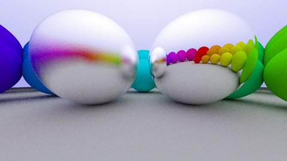
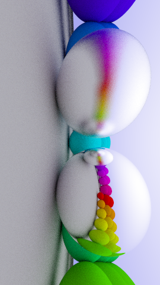
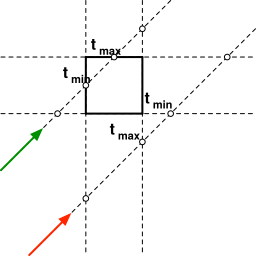

This page is the counterpart of `test/decks/media-deck.md`. It uses the same
media elements, but in one continuous document. Slide separators, columns,
fragments and popups do not apply to pages and are left out.

# Images

## Local image



## Local image with caption block

The text of the image is discarded in favor of the block caption.


Caption: Block Caption $e=mc^2$

## Width

`{width="50%"}`

{width="50%"}

## Height and alignment

`{align="right" height="200px"}`

{align="right"
height="200px"}

## Width, height and title

`{align="right" width="80%" height="200px"}`

{align="right" width="80%"
height="200px"}

# Media in a row

## Two images in a row

Four images, actually. A line block puts media side by side.

| 
| 
| {w:h="3/2.03"}
| 

Caption: Aspect ratio of images is determined at compile time, or can be
specified.

## Three somethings in a row

| 
| {.controls}
| {w:h="1/1"}

Caption: Caption all the things

# Inline media

Some text {.controls .autoplay height="3em"}
some more {.code height="3em" width="10em"} code.

{height="60px"}{height="120px"}{height="240px"}

# Embedded SVG

## From a local file

{.embed width="400px"}

## With a fixed height

{.embed height="256px"}

# Video

## Local video

{.controls .autoplay
width="60%"}

## YouTube video stream

{width="80%"}

# Embedded documents

## Iframe

{.iframe width="80%"}

## PDF object

{.pdf w:h="2/1"}

## Mview iframe

``` markdown

```

renders as


# Code

## Code block with caption

``` javascript
function rainbow(numOfSteps, step) {
  // This function generates vibrant, "evenly spaced" colours (i.e. no clustering). This is ideal for creating easily distinguishable vibrant markers in Google Maps and other apps.
  // Adam Cole, 2011-Sept-14
  var r, g, b;
  var h = step / numOfSteps;
```

Caption: Captioned code.

More `function CODE(here) {return true;}`{.javascript} here.

## Selected line numbers

``` {.html line-numbers="1-4,6,7"}
<div class="media">
  <figure class="image">
    
    <figcaption>
      Alt Caption <span class="math inline">\(e=mc^2\)</span>
    </figcaption>
  </figure>
</div>
```

Caption: General structure of all media embeddings

# Rendered code

## From a file

{.dot .render align="right" width="50%"}

Caption: Graphviz is cool.

## From a code block

``` {.dot .render align="right" width="50%"}
digraph {
  node [style = filled]
  A [fillcolor = yellowgreen]
  A -> B
  A -> C
  C -> D
  C -> E
  C -> F
  B -> D
}
```

Caption: Graphviz is cool.

## Inline

*Really* tiny: {.dot .render height="3em"}
{.dot .render height="2em"} {.dot
.render height="1em"}

# Executed JavaScript

## From a file

{.javascript .run}

## From a code block

``` {.javascript .run}
import * as mod from "../static/es6.js";
mod.hello(anchor, "orange");
```

Caption: What?

## Inline

-   Animation {.javascript .run} is followed by text
